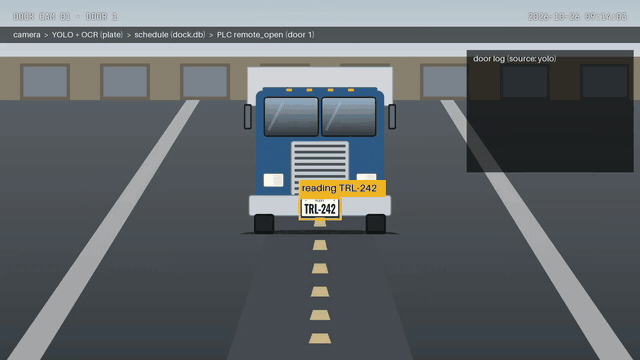
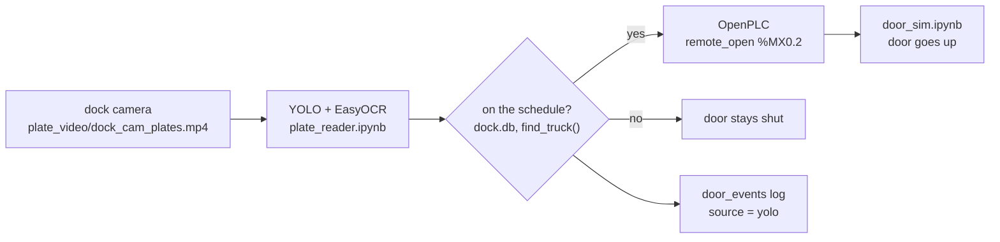

# PLC + YOLO garage door (simulated)

a dock camera reads the plate on each truck, checks it against today's delivery schedule, and if the truck is expected it tells the PLC to open the door. the PLC still runs the door with ordinary ladder logic. every decision is logged.

everything is simulated and runs on one laptop: the trucks are drawn, the door is a python script, and the PLC is the OpenPLC runtime in docker.



episode 1 of a series on what an AI builder does with the labs in a PLC course (Johnston Community College, Advanced Manufacturing Training Facility, Four Oaks NC). next lab: the silo line.

## how it works



- **YOLO** looks for a vehicle (car, bus, truck). it does not read text
- **EasyOCR** reads the plate
- **dock.db** holds the schedule (`shipments`, the `truck_id` column is the plate) and the log (`door_events`)
- **OpenPLC** runs the ladder. python pulses `remote_open` over modbus and the ladder seals in `motor_up`
- **door_sim** plays the door: reads the motor outputs, writes the limit switches back

## what's in here

| path | what it is |
| --- | --- |
| `project.json`, `pous/`, `devices/`, `datatypes/` | the OpenPLC Editor project (garage door ladder) |
| `docs/main_ladder.st` | the same ladder as structured text, for reading without the Editor |
| `door_sim.ipynb` | python plays the door |
| `dock_shipments.ipynb` | builds the fake schedule in dock.db, helper functions, opens the door from python |
| `plate_reader.ipynb` | the AI notebook: reads the video, checks the schedule, opens the door, scores itself, makes a result video |
| `plate_video/` | the test video (16 vehicles), its answer key, and the HyperFrames files that build it |
| `docs/dock_cam_result.mp4` | the test video with what the AI saw drawn on top |
| `docker-compose.yml`, `Dockerfile`, `pyproject.toml`, `uv.lock` | two containers (openplc + jupyter) with pinned python packages |

## what you need

- Docker Desktop
- [OpenPLC Editor](https://autonomylogic.com/) (to upload the ladder and use the debugger)
- a browser

python, packages and the PLC runtime come from the containers.

## start up

1. open Docker Desktop and wait until it says running
2. in a terminal, in this folder:
    ```
    docker compose up -d --build
    docker compose ps
    ```
    two rows, `openplc` and `notebooks`, both Up. after the first time, `docker compose up -d` is enough
3. OpenPLC Editor:
    1. open this folder as the project
    2. Device > Configuration > IP `127.0.0.1` > Connect (log in to the runtime when asked)
    3. Build and upload, then start the PLC (play button)
    4. open the debugger
4. browser: `http://127.0.0.1:8888`
5. open `door_sim.ipynb` > Run All. it prints `connected. door starts shut` and the bar shows `0.0% open`
6. open `dock_shipments.ipynb` and run it one cell at a time through step 9. this makes `dock.db` with today's schedule (`seed=42`, same 8 trucks every time)

## run the AI

open `plate_reader.ipynb` and go one step at a time.

| step | does | notes |
| --- | --- | --- |
| 1 | installs `ultralytics` and `easyocr` | uses `uv` because the container's python has no pip. **restart the kernel after**. redo after every `docker compose down` |
| 2 | settings | `LIVE = False` by default |
| 3 | loads the models | first run downloads `yolo11n.pt` (~5 MB) and EasyOCR (~100 MB) |
| 4 | the plate reader | YOLO box if it finds a vehicle, otherwise a fixed plate zone, then OCR |
| 5 | one frame | shows what the AI sees |
| 6 | reads the whole video | the slow part, a few minutes on a laptop |
| 7 | reads into arrivals | the same plate read twice in a row = one truck |
| 8 | checks the schedule, opens the door | same logic as dock_shipments, logged with `source = yolo` |
| 9 | scores against `plate_video/ground_truth.csv` | |
| 10 | door log | |
| 11 | makes `plate_video/dock_cam_result.mp4` | |

**test mode vs live**

- `LIVE = False`: works on an in-memory copy of dock.db and never touches the PLC. same score every run
- `LIVE = True`: writes to dock.db and pulses `remote_open`. door_sim and the PLC must be running and the door shut. the first expected truck opens the door

live mode marks trucks as arrived. before running step 8 again, close the door and reset the schedule (`dock_shipments.ipynb` step 9).

## results

| | |
| --- | --- |
| door decisions right | 16 of 16 |
| plates read exactly | 15 of 16 (TRL-000 read as TRL-OOO, and still turned away) |
| near-miss plates turned away | 3 of 3 (TRL-I95, TRL-528, TRL-44B) |
| vehicles YOLO found | almost none, see limits |

## limits

- **simulated.** the trucks are drawings and the door is a python script. nothing here is safety-rated or meant for a real door
- **YOLO and drawings.** the pretrained model (COCO photos) mostly does not recognize the drawn vehicles, so the plate reads come from the fixed plate zone. this video tests OCR and the schedule check well and YOLO very little
- **no lookalike fixing.** the reader does not swap O/0, I/1 or B/8 on purpose. if it did, the near-miss plates would open the door
- **one open per run in live mode.** the ladder has no remote close, so after the first truck the door stays open and later pulses are only logged

## the ladder

```
rung 1  motor_up
  NOT motor_down AND NOT top_limit AND NOT stob_pb
  AND (motor_up OR open_pb OR remote_open)          seal-in on motor_up

rung 2  motor_down
  NOT motor_up AND NOT bottom_limit AND NOT stob_pb
  AND (motor_down OR (ready AND close_pb))

rung 3  open_lamp  := top_limit
rung 4  shut_lamp  := bottom_limit
rung 5  ajar_lamp  := NOT top_limit AND NOT bottom_limit
rung 6  ready (set)   when nothing is pressed and no motor is running
rung 7  ready (reset) when either motor runs
```

| variable | location | modbus coil | written by |
| --- | --- | --- | --- |
| open_pb | %IX0.0 | | debugger |
| close_pb | %IX0.1 | | debugger |
| stob_pb | %IX0.2 | | debugger |
| top_limit | %MX0.0 | 8192 | door_sim |
| bottom_limit | %MX0.1 | 8193 | door_sim |
| remote_open | %MX0.2 | 8194 | dock_shipments, plate_reader |
| motor_up | %QX0.0 | 0 | PLC |
| motor_down | %QX0.1 | 1 | PLC |
| open_lamp | %QX0.2 | | PLC |
| shut_lamp | %QX0.3 | | PLC |
| ajar_lamp | %QX0.4 | | PLC |

`%MX` bits are written over modbus, so force them from python, not the debugger.

## make your own test video

the video is built with [HyperFrames](https://github.com/heygen-com/hyperframes) (html rendered to video). edit `plate_video/lineup.json` to change plates, vehicles, angle, dim light or a dirty plate, then:

```
cd plate_video
python3 build.py
npx hyperframes render --output dock_cam_plates.mp4
```

needs node 22+ and ffmpeg. `build.py` also rewrites `ground_truth.csv`, so the answer key always matches the video. all plates are made up.

## troubleshooting

| problem | fix |
| --- | --- |
| `No module named cv2` | step 1 didn't install. run it, then restart the kernel |
| port is already allocated | an old OpenPLC container is running: `docker stop openplc-runtime` |
| `Could not verify MD5` in the Editor | click OK, then Build and upload. the PLC was empty |
| nothing lights up in live mode | the right project isn't loaded in the PLC, or `LIVE` is still False |
| every truck says not on schedule | an earlier live run marked them arrived. reset with dock_shipments step 9 |
| door stuck, `ajar_lamp` on | force `stob_pb` True then False to break the seal-in, then check door_sim is running |

## shut down

1. door_sim: Interrupt (■)
2. `docker compose down`

## credits and licenses

- [OpenPLC](https://autonomylogic.com/) runtime and editor
- [Ultralytics YOLO](https://github.com/ultralytics/ultralytics) (AGPL-3.0, installed by the notebook, not included here)
- [EasyOCR](https://github.com/JaidedAI/EasyOCR) (Apache-2.0)
- [HyperFrames](https://github.com/heygen-com/hyperframes) (Apache-2.0) for the test video
- [pymodbus](https://github.com/pymodbus-dev/pymodbus)

built by Dr. Jeanne McClure, Ars Innovate Technologies.
